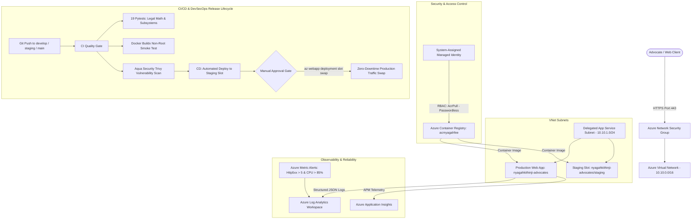

# ⚖️ Nyaga Law — Enterprise Legal Microservice & Azure Cloud Infrastructure
> Production-grade Python 3.11 FastAPI backend microservice for Kenyan Advocates Remuneration Order calculations, taxation engines, 2FA OTP security, and legal file metadata processing.
> Designed for enterprise reliability, high availability, and zero-downtime operations on **Microsoft Azure**.

[](https://github.com/guyo-halake/nyagahK_azure_backend/actions/workflows/ci.yml)
[](https://github.com/guyo-halake/nyagahK_azure_backend/actions/workflows/cd-azure.yml)


---

## 🏛️ Enterprise Cloud Architecture (Microsoft Azure)



---

## 🚀 Cloud & DevOps Engineering Highlights

### 1. Declarative Infrastructure as Code (Terraform `azurerm`)
Located in [`azure/terraform/`](file:///azure/terraform):
* **Modular Infrastructure**:
  * [`network.tf`](file:///azure/terraform/network.tf): Provisions VNet (`10.10.0.0/16`), delegated subnet for Regional VNet Integration, and Network Security Group enforcing HTTPS (Port 443) and denying cleartext HTTP.
  * [`acr.tf`](file:///azure/terraform/acr.tf): Azure Container Registry with **Admin credentials disabled** in favor of passwordless RBAC.
  * [`app_service.tf`](file:///azure/terraform/app_service.tf): Linux App Service Plan, Production Web App, and **Staging Slot** for blue/green zero-downtime releases.
  * [`monitoring.tf`](file:///azure/terraform/monitoring.tf): Log Analytics Workspace (30-day retention), Application Insights APM, Diagnostic settings streaming console/HTTP logs, and SRE metric alerts for HTTP 5xx errors and CPU spikes.
  * [`outputs.tf`](file:///azure/terraform/outputs.tf) & [`variables.tf`](file:///azure/terraform/variables.tf): Clean parameterized deployment spec.

### 2. Deterministic & Reproducible Docker Builds
* **Pinned Base Image**: `python:3.11.8-slim-bookworm` (eliminates unexpected upstream Debian package breaks).
* **CIS Docker Benchmark Compliance**: Runs under dedicated unprivileged system account (`USER appuser`, UID `10001`, GID `10001`).
* **Zero Compiler Tools in Production**: Multi-stage build discards GCC, Make, and build headers after compilation.
* **Health Probes**: Integrated `HEALTHCHECK` running every 30 seconds against `/api/v1/health`.

### 3. Observability & Distributed Tracing
* **Structured JSON Logging** (`app/core/structured_logging.py`):
  Every incoming request emits machine-readable JSON directly to stdout for ingestion into Log Analytics:
  ```json
  {"timestamp": "2026-10-20 11:16:08", "level": "INFO", "service": "nyaga-law-backend", "correlation_id": "fece4df0-021b-...", "status_code": 200, "latency_ms": 3.1}
  ```
* **Correlation IDs**: `CorrelationIdMiddleware` assigns or propagates an `X-Correlation-ID` header across every request and log line.
* **Liveness vs Readiness Separation**:
  * `GET /api/v1/health`: Lightweight liveness probe for Docker and Azure pingers.
  * `GET /api/v1/health/ready`: Subsystem verification (Statutory Engine, Supabase, SMTP gateway) checked prior to slot traffic swaps.

### 4. SRE Incident Response Runbook
Located in [`azure/INCIDENT_RESPONSE_RUNBOOK.md`](file:///azure/INCIDENT_RESPONSE_RUNBOOK.md):
* Severity classification matrix (SEV-1 through SEV-3).
* 5-minute initial triage runbook.
* **Emergency Zero-Downtime Rollback**:
  ```bash
  az webapp deployment slot swap --resource-group rg-nyagahfee-prod --name nyagahkithinji-advocates --slot staging --target-slot production
  ```
* Kusto Query Language (KQL) queries for Log Analytics (tracing correlation IDs, error spikes, P95/P99 latency).
* Post-Incident Review (PIR) template with Root Cause Analysis (5 Whys).

---

## ⚡ Quick Start (Local Docker)

```bash
# Clone the repository
git clone https://github.com/guyo-halake/nyagahK_azure_backend.git
cd nyagahK_azure_backend

# Run local container stack
docker compose up --build -d
```
* **Interactive API Documentation (Swagger)**: [http://localhost:8000/docs](http://localhost:8000/docs)
* **ReDoc API Reference**: [http://localhost:8000/redoc](http://localhost:8000/redoc)
* **Liveness Probe**: [http://localhost:8000/api/v1/health](http://localhost:8000/api/v1/health)
* **Readiness Probe**: [http://localhost:8000/api/v1/health/ready](http://localhost:8000/api/v1/health/ready)

---

## 🧪 Automated Testing

Execute the 19 automated Pytests verifying statutory law math, security algorithms, and health endpoints:
```bash
python -m pytest app/tests -v
```
