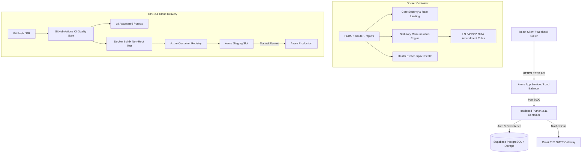

# ⚖️ Nyaga Law — Legal Remuneration Engine & Azure Cloud API
> Production-grade Python 3.11 FastAPI backend microservice for Kenyan Advocates Remuneration Order calculations, taxation engines, 2FA OTP security, and legal file metadata processing.

[](https://github.com/guyo-halake/nyagahK_azure_backend/actions/workflows/ci.yml)
[](https://github.com/guyo-halake/nyagahK_azure_backend/actions/workflows/cd-azure.yml)


---

## 🏛️ System Architecture



---

## 🚀 Key Engineering Features

1. **Kenyan Advocates Remuneration Engine (`app/engine/remuneration_engine.py`)**:
   - Automated legal bill calculation under **Kenya Law LN 64/1962 (2014 Amendment Order)**.
   - **Schedule 6 (High Court, Court of Appeal, ELC, ELRC)** ad valorem scale calculations.
   - **Schedule 7 (Subordinate / Magistrate's Courts)** scale calculations.
   - **Getting-Up Fees** (33.33% / 1/3 of instruction fee floor).
   - Itemized folio work (Drawings @ Kshs 500/folio, Copying @ Kshs 50/folio, Court Attendances @ Kshs 2,500/hr, Demand Letters @ Kshs 500) + 16% VAT computation.
   - Validated against precedent taxation records (*Seyani Brothers v Greenhills* [KES 30.8M], *Dhanya Construction v Sunil Shah*).

2. **Enterprise Containerization (`Dockerfile`)**:
   - Multi-stage build separating compiler toolchains from runtime.
   - Runs as non-root user (`USER appuser`, UID `10001`).
   - Built-in container health check probe.

3. **Multi-Environment Cloud Pipeline**:
   - **Develop**: Automated PR validation with 18 Pytests and Docker Buildx smoke test.
   - **Staging**: Automated deployment to Azure Staging App Service with post-deploy verification.
   - **Production**: Protected environment deployment with zero downtime.

---

## ⚡ Quick Start (Docker)

```bash
# Clone the backend repository
git clone https://github.com/guyo-halake/nyagahK_azure_backend.git
cd nyagahK_azure_backend

# Launch the containerized backend
docker compose up --build -d
```

* **Interactive Swagger UI**: [http://localhost:8000/docs](http://localhost:8000/docs)
* **ReDoc Documentation**: [http://localhost:8000/redoc](http://localhost:8000/redoc)
* **Liveness & Readiness Probe**: [http://localhost:8000/api/v1/health](http://localhost:8000/api/v1/health)

---

## 🧪 Running Automated Tests

```bash
# Run all 18 Pytests locally
python -m pytest app/tests -v
```
